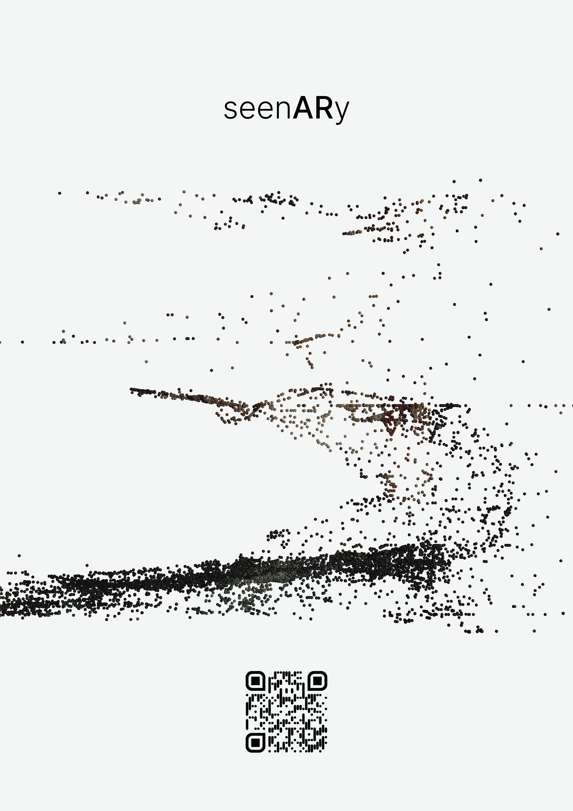

# ✿  - MindAR + Three.js

an AR Project + Photograph   

Description:  
The sttered particles, once when "observed", reveals its real definitive state. Scan the QR Code below to see the reveal.
 

Link to the project: [https://mjlmb-z.github.io/seenARy/](https://mjlmb-z.github.io/seenARy/)
